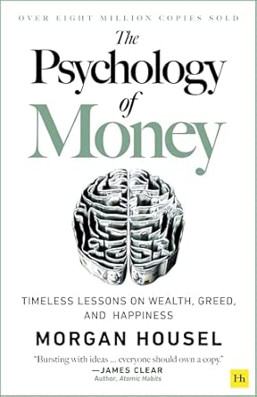

  

<h1 align="center">🚀 ترجمه جامع و آزاد کتاب The Psychology of Money</h1>

  <strong>درس‌هایی جاودان درباره ثروت، طمع و خوشبختی؛ نگاهی رفتاری و روان‌شناختی به تصمیم‌های مالی و زندگی</strong>

  

  

  

  

  

---

## 💡 چرا این پروژه؟

کتاب **The Psychology of Money (روان‌شناسی پول)** نوشته‌ی *مورگان هاوسل (Morgan Housel)*، نشان می‌دهد که موفقیت مالی و آرامش اقتصادی نه به پیچیدگی فرمول‌های ریاضی، بلکه به **رفتار، خویشتن‌داری و درک درست از شانس، ریسک و بهره‌ مرکب** وابسته است.

هدف ما در این پروژه اوپن‌سورس:
* 🎯 **ترجمه‌ای روان، صمیمی و ملموس** برای انتقال دقیق داستان‌ها و بینش‌های کتاب
* 💻 **ارائه کامل و رایگان تمام ۲۲ بخش کتاب** در قالب Markdown ساختاریافته
* 🌍 **ترویج سواد مالی و نگرش سالم** در میان مخاطبان و برنامه‌نویسان فارسی‌زبان

---

  ## ⚡ دسترسی سریع

| مرجع | توضیحات | لینک |
| :--- | :--- | :---: |
| 📖 **نسخه وب (گیتاب)** | تجربه خواندن تعاملی با پوسته تاریک/روشن و جستجوی سریع | [ورود به گیتاب ↗](https://hheydarian.github.io/Gitab/) |
| 📥 **فصل‌های کتاب (Markdown)** | مشاهده و مطالعه مستقیم فایل‌های فارسی در پوشه فصل‌ها | [مشاهده پوشه Book ↗](Book/) |

---

## 🔍 راهنمای خوانایی بهتر در گیت‌هاب

برای اینکه متون فارسی در گیت‌هاب و مرورگر با خط استاندارد و چشم‌نواز نمایش داده شوند:
1. افزونه رایگان **[فونت ایران (FontIran)](https://chromewebstore.google.com/detail/fontiran/edbchgkbejkdkdkpgenlaciegoidmjoh)** را روی مرورگر نصب کنید.
2. فونت پیش‌فرض را روی **وزیرمتن (Vazirmatn)** یا **ایران‌یکان** قرار دهید تا خوانایی کدها و متن به اوج برسد.

---

## 📚 فهرست سرفصل‌ها

تمامی **۲۲ فصل، مقدمه و پس‌گفتار** کتاب به طور کامل ترجمه شده و آماده مطالعه است:

| شماره | نام سرفصل (انگلیسی) | عنوان فارسی | وضعیت | مطالعه مستقیم |
| :---: | :--- | :--- | :---: | :---: |
| **00** | Introduction: The Greatest Show on Earth | مقدمه: بزرگ‌ترین نمایش روی زمین | ✅ | [مطالعه فصل](Book/00/Introduction.md) |
| **01** | No One's Crazy | هیچ‌کس دیوانه نیست | ✅ | [مطالعه فصل](Book/01/No_Ones_Crazy.md) |
| **02** | Luck & Risk | شانس و ریسک | ✅ | [مطالعه فصل](Book/02/Lock%26Risk.md) |
| **03** | Never Enough | هرگز کافی نیست | ✅ | [مطالعه فصل](Book/03/Never_enough.md) |
| **04** | Confounding Compounding | قدرت شگفت‌انگیز بهره مرکب | ✅ | [مطالعه فصل](Book/04/Confounding_Compounding.md) |
| **05** | Getting Wealthy vs. Staying Wealthy | ثروتمند شدن در برابر ثروتمند ماندن | ✅ | [مطالعه فصل](Book/05/Getting_Wealthy_vs_Staying_Wealthy.md) |
| **06** | Tails, You Win | دم‌ها؛ تو برنده‌ای | ✅ | [مطالعه فصل](Book/06/Tails_You_Win.md) |
| **07** | Freedom | آزادی | ✅ | [مطالعه فصل](Book/07/Freedom.md) |
| **08** | Man in the Car Paradox | پارادوکس مردِ داخل خودرو | ✅ | [مطالعه فصل](Book/08/Man_in_the_Car_Paradox.md) |
| **09** | Wealth is What You Don't See | ثروت آن چیزی است که نمی‌بینید | ✅ | [مطالعه فصل](Book/09/ealth_is_What_You_Don't_See.md) |
| **10** | Save Money | پول پس‌انداز کن | ✅ | [مطالعه فصل](Book/10/Save_Money.md) |
| **11** | Reasonable > Rational | معقول بودن در برابر منطقی بودن | ✅ | [مطالعه فصل](Book/11/Reasonable_Retional.md) |
| **12** | Surprise! | غافلگیری! | ✅ | [مطالعه فصل](Book/12/Surprise.md) |
| **13** | Room for Error | جا برای خطا | ✅ | [مطالعه فصل](Book/13/Room_for_Error.md) |
| **14** | You'll Change | شما تغییر خواهید کرد | ✅ | [مطالعه فصل](Book/14/Youll_Change.md) |
| **15** | Nothing's Free | هیچ چیز مجانی نیست | ✅ | [مطالعه فصل](Book/15/Nothings_Free.md) |
| **16** | You & Me | من و تو | ✅ | [مطالعه فصل](Book/16/You%26Me.md) |
| **17** | The Seduction of Pessimism | اغواگری بدبینی | ✅ | [مطالعه فصل](Book/17/The_Seduction_of_Pessimism.md) |
| **18** | When You'll Believe Anything | وقتی هر چیزی را باور می‌کنید | ✅ | [مطالعه فصل](Book/18/When_You'll_Believe_Anything.md) |
| **19** | All Together Now | حالا همه با هم | ✅ | [مطالعه فصل](Book/19/All%20_Together%20_Now.md) |
| **20** | Confessions | اعترافات | ✅ | [مطالعه فصل](Book/20/Confessions.md) |
| **21** | Postscript: A Brief History of Why the U.S. Consumer Thinks the Way They Do | پس‌گفتار: تاریخچه‌ای کوتاه | ✅ | [مطالعه فصل](Book/POSTSCRIPT/A_Brief_History.md) |

---

## 🤝 مشارکت در پروژه (Contributions Welcome)

این یک پروژه اجتماعی متعلق به تمام توسعه‌دهندگان و علاقه‌مندان است. هر تصحیح نگارشی، بهبود در واژه‌گزینی‌های تخصصی یا بهینه‌سازی ساختار متن، ارزش این منبع را دوچندان می‌کند:

1. **فورک کنید (Fork):** ریپازیتوری را فورک کرده و یک برنچ جدید بسازید (`git checkout -b feature/edit-chapter-01`).
2. **اصلاح و بازبینی:** متن یا بخش‌های مورد نظر را اصلاح کنید.
3. **کامیت و ارسال:** تغییرات را ثبت کرده و یک Pull Request تمیز ارسال فرمایید.

> اگر سوال، ابهام یا پیشنهادی درباره مطالب یا ترجمه دارید، خوشحال می‌شویم آن را از طریق بخش **[Issues](https://github.com/hheydarian/the-psychology-of-money/issues)** مطرح کنید.

---

## ⚖️ مجوز و حقوق مالکیت معنوی

* **کتاب اصلی:** حقوق نشر و مادی/معنوی اثر اصلی متعلق به **Morgan Housel** و انتشارات **Harriman House** است.
* **فایل‌های مخزن و ترجمه:** مطابق فایل [LICENSE](LICENSE) در این مخزن منتشر شده و متن ترجمه فارسی با هدف مطالعه رایگان و غیرتجاری در دسترس قرار گرفته است.

---

  ⭐ <strong>اگر این ترجمه و ریپازیتوری برایتان مفید بوده، با دادن یک ستاره (Star) به دیده شدنش توسط دیگران کمک کنید!</strong> ⭐

  ساخته شده با ❤️ برای جستجوگران آرامش و دانش مالی

